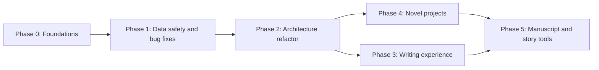

# Noveler: Improvement Plan

## ✅ Progress

| Phase | Status | Commit |
|---|---|---|
| Phase 0: Foundations | **Done** | `d518207` |
| Phase 1: Data safety and critical fixes (C1–C5, H2, plus H3 and an H4 stopgap) | **Done** | `d518207` |
| Phase 2: Architecture refactor | **Done**: MarkdownManager + ProseMirror serialization, debounced counts/sync, DOCX tree-walker, settings persistence | `7830b06` |
| Phase 3: Writing experience | **Done**: Typewriter scrolling, distraction-free focus mode, find & replace with regex/case/whole-word, word goals & manuscript stats, Command Palette (`Ctrl+K`), selection counts | `29fc6cc` |
| Phase 4: Novel project model | **Done**: `noveler.json` project format, recursive binder tree, scene metadata, outline/corkboard view, scene inspector, tree filesystem commands | `30bc279` |
| Phase 5: Manuscript compile and story tools | **Done**: Multi-scene manuscript compiler (Standard Manuscript Shunn DOCX, Clean DOCX, Markdown), Story Bible / Codex with entity mention detection, Prose Diagnostics (readability, adverbs, filter words, passive voice, rhythm), Scene Snapshots & version history | `2efc545` |

## 1. What's there now

| Layer | Stack | Notes |
|---|---|---|
| Shell | Tauri 2 (Rust) | 3 commands: `read_file`, `write_file`, `read_dir` ([commands.rs](file:///e:/Projects/Noveler2/src-tauri/src/commands.rs)) |
| UI | React 19 + Zustand 5 | One global store ([editorStore.ts](file:///e:/Projects/Noveler2/src/stores/editorStore.ts)) |
| Editor | TipTap 3 (WYSIWYG) | Markdown ↔ HTML round-trip via `marked` + `turndown` ([markdown.ts](file:///e:/Projects/Noveler2/src/utils/markdown.ts)) |
| Export | `docx` lib + `window.print()` | Hand-rolled line parser for DOCX ([docx.ts](file:///e:/Projects/Noveler2/src/export/docx.ts)) |

The base is clean: a small codebase (~1,000 lines of TS), strict TypeScript that type-checks, three themes, and a sensible component layout. Right now it is a **single-file Markdown editor with a fiction-flavoured look**. It doesn't yet work as a **novel-writing tool**. Before adding features, some bugs that can lose data or corrupt files need fixing.

---

## 2. Bugs found (sorted by severity)

### 🔴 Critical: data loss or corrupt output

| # | Problem | Where | Fix |
|---|---|---|---|
| C1 | **DOCX export in the desktop app writes a corrupt file.** The binary blob is turned into a JS "binary string" and passed to `write_file(content: String)`. Rust writes it as UTF‑8, so every byte ≥ 0x80 becomes 2 bytes and the ZIP breaks. The Save dialog also offers only `.md`/`.txt` filters. | [docx.ts#L194-L202](file:///e:/Projects/Noveler2/src/export/docx.ts#L194-L202), [commands.rs#L17-L25](file:///e:/Projects/Noveler2/src-tauri/src/commands.rs#L17-L25) | Add a `write_binary_file(path, bytes: Vec<u8>)` command (or use `tauri-plugin-fs`), plus a `.docx` save filter. |
| C2 | **No unsaved-changes guard.** New, Open, opening a file from the sidebar, drag-drop and closing the window all throw away dirty content without asking. An *Untitled* document is never autosaved. | [editorStore.ts#L180-L256](file:///e:/Projects/Noveler2/src/stores/editorStore.ts#L180-L256) | Add a central `confirmDiscardIfDirty()` and a Tauri `onCloseRequested` handler. Autosave untitled work to a recovery file in app-data. |
| C3 | **Print/PDF gives a blank page in the default view.** The print CSS hides the editor and shows the preview, but `<Preview>` isn't mounted when `viewMode === 'editor'`, which is the default. | [App.tsx](file:///e:/Projects/Noveler2/src/App.tsx), [global.css print block](file:///e:/Projects/Noveler2/src/styles/global.css) | Render a hidden print-only manuscript all the time, or switch to preview before printing. |
| C4 | **Drag-and-drop gives a wrong save path.** `file.path` doesn't exist in Tauri's webview, so `filePath` becomes the bare file name. Autosave then writes `chapter.md` into the **process working directory**, not the original file. In the browser build, autosave starts a download every 1.5 s. | [Editor.tsx#L78-L98](file:///e:/Projects/Noveler2/src/components/Editor/Editor.tsx#L78-L98), [Editor.tsx#L50-L57](file:///e:/Projects/Noveler2/src/components/Editor/Editor.tsx#L50-L57) | Use Tauri's `onDragDropEvent` (it gives real paths). Turn off autosave when there is no real path or when running outside Tauri. |
| C5 | **Saves aren't atomic.** `fs::write` truncates the file first, so a crash or power loss mid-save can wipe a chapter. `create_dir_all` errors are also ignored. | [commands.rs#L17-L25](file:///e:/Projects/Noveler2/src-tauri/src/commands.rs#L17-L25) | Write to `file.tmp`, `fsync`, then rename. Keep a rolling `.bak` or snapshot. |

### 🟠 High: correctness and security

| # | Problem | Where |
|---|---|---|
| H1 | **The Markdown round-trip changes files.** `marked({breaks:true})` turns single newlines into ` `, and turndown writes them back as `"  \n"`. Turndown also escapes text (`1984.` → `1984\.`, `_`, `*`, `#`). Text alignment is never saved because Markdown can't represent it. Opening and saving a file can silently rewrite it. | [markdown.ts](file:///e:/Projects/Noveler2/src/utils/markdown.ts) |
| H2 | **XSS that can reach the filesystem.** The preview injects unsanitised `marked` output through `dangerouslySetInnerHTML`. CSP is `null`. `read_file`/`write_file` accept *any* path. A malicious `.md` file could read or write files anywhere on disk. | [Preview.tsx](file:///e:/Projects/Noveler2/src/components/Preview/Preview.tsx), [tauri.conf.json](file:///e:/Projects/Noveler2/src-tauri/tauri.conf.json) |
| H3 | **The DOCX inline parser mangles output.** `<u>…</u>` is written out literally. With `<mark>…</mark>` the `<` is dropped and `mark>` appears in the text. `***bold-italic***`, escaped characters (`\*`) and lists aren't handled. | [docx.ts#L208-L257](file:///e:/Projects/Noveler2/src/export/docx.ts#L208-L257) |
| H4 | **Clicking a folder in the sidebar shows a "Failed to read file" error.** Folders are listed but can't be opened, and the directory scan isn't recursive. | [Sidebar.tsx#L85-L98](file:///e:/Projects/Noveler2/src/components/Sidebar/Sidebar.tsx#L85-L98) |

### 🟡 Medium: performance and UX

- **Too much work on every keystroke.** Each key press runs Turndown over the *whole document*, plus `getText()` and the word count. Every component also subscribes to the *whole* store (`useEditorStore()` with no selector), so Toolbar, StatusBar, Preview and App all re-render. At novel length (80–120k words) typing will lag.
- **Toolbar buttons can show the wrong state.** Active states (bold, italic…) only refresh when the store changes, so moving the cursor without typing doesn't update them. Use TipTap's `useEditorState`.
- **Settings are forgotten.** `viewMode`, sidebar state and autosave aren't persisted, and autosave can't be toggled anywhere in the UI. The last project and recent files aren't remembered.
- **The scrollbar sits in the middle of the window.** `.editor-container` is both the scroll container and limited to 800px wide.
- **Spellcheck is never configured.**

### ⚪ Housekeeping

- **There is no git repository.** This should be done first.
- No tests, linter, formatter or README.
- A 9.6 MB `Noveler.exe` and a `.lnk` shortcut sit in the repo root.
- Leftover boilerplate:
  - `Cargo.toml` still has `description = "A Tauri App"` and `authors = ["you"]`.
  - Versions don't match: `0.0.0` in `package.json` vs `0.1.0` in Tauri.
  - `tauri-plugin-log` and `log` are dependencies but never used.
  - Vite template assets are unused (`hero.png`, `vite.svg`, `typescript.svg`, `icons.svg`).

---

## 3. Roadmap

### Phase 0: Foundations (½ day)
1. `git init`. Ignore `*.exe`, `*.lnk` and `src-tauri/target`, then make the first commit.
2. Add ESLint + Prettier and the scripts `typecheck`, `lint`, `test`.
3. Add **Vitest** with a first batch of tests for `markdownToHtml`/`htmlToMarkdown` round-trips. These protect H1 before refactoring.
4. Remove unused assets and dependencies, and fix the Cargo/package metadata.
5. Write a README covering build and run instructions and the feature list.

### Phase 1: Data safety and critical fixes (2–3 days)
1. **C1:** add a binary write command and fix the DOCX save filter.
2. **C2:** add a dirty-check dialog before New, Open, opening from the sidebar, drop and close. Add crash-recovery autosave for untitled work.
3. **C3:** make print/PDF work in every view mode.
4. **C4:** use Tauri's native drag-drop and protect autosave from bad paths.
5. **C5:** atomic writes, plus a `.noveler/backups/` rolling backup (last N saves per file).
6. **H2:** sanitise preview HTML with DOMPurify, set a strict CSP, and limit file commands to the open project folder and dialog-chosen paths.

### Phase 2: Architecture refactor (3–5 days)
1. **Replace the `marked` + `turndown` round-trip** with a real Markdown serializer: `@tiptap/markdown` (official in v3) or `prosemirror-markdown`. Treat the *Markdown file* as the source of truth. Goal: open→save with no edits produces the same bytes, and the tests prove it. Remove the alignment buttons, or store alignment explicitly (for example as an attribute), so nothing is silently lost.
2. **Make the scene break a first-class node.** Today's `---` horizontal rule becomes a "Scene Break" node, shown as a centred `* * *` or `#`.
3. **Split the store into slices** (`document`, `project`, `ui/settings`) and use selectors (`useEditorStore(s => s.wordCount)`) or `useShallow`. Move autosave out of the component into a debounced store subscription.
4. **Debounce the expensive work.** Convert to Markdown only on save, autosave and preview (preview debounced at about 300 ms). Count words incrementally or after a 250 ms debounce.
5. **Add a settings service**, persisted with `tauri-plugin-store`: theme, font family and size, line width, line height, autosave interval, last project, recent files.
6. **Rewrite DOCX export to walk the ProseMirror document tree** instead of re-parsing Markdown with regexes. This fixes H3 and makes formatting consistent.

### Phase 3: Writing experience (1–2 weeks)
| Feature | Why it matters for fiction |
|---|---|
| **Focus / typewriter mode**: fullscreen, toolbar hidden, current line kept centred, other paragraphs dimmed | The main promise of a "distraction-free" editor |
| **Find & replace** (in the current file, then project-wide, with optional regex) | Renaming a character, fixing a repeated tic |
| **Writing goals and stats**: session words, daily target, project target with deadline, streak, history chart | The motivation loop novelists use (NaNoWriMo-style) |
| **Better counts**: words in the selection, words per chapter, estimated pages (≈250 words/page), reading time | Manuscript planning |
| **Native menu bar** (Tauri menu) plus a command palette (`Ctrl+K`) and a configurable shortcuts list | Discoverability. The toolbar is already crowded. |
| **Spellcheck** with a custom project dictionary for invented names | Fantasy and SF names otherwise get flagged everywhere |
| **Typography settings**: font, size, line width, paragraph style (indented vs block) | Writers are particular about how the page looks |
| **Smarter toolbar**: drop lists and alignment from the default set, add Scene Break, a dialogue/em-dash helper and Comment | Fit the toolbar to fiction, not general documents |

### Phase 4: Novel project model (2–3 weeks)
This step turns Noveler from a Markdown editor into a novel-writing tool.

1. **Project file** `noveler.json` in the project root. It holds the ordered tree of parts, chapters and scenes, plus targets, metadata and compile settings. Scenes stay as plain `.md` files, so they work with git, Dropbox and other editors.
2. **Binder sidebar**: a recursive tree with drag-and-drop reordering, new/rename/delete/duplicate, and a trash folder. Rust needs `create`, `rename`, `delete`, `move` and a recursive `read_dir`, plus a file watcher (`notify`) for changes made outside the app.
3. **Per-scene metadata** in YAML front-matter: synopsis, POV character, status (Idea → Draft → Revised → Final), labels, word target. The editor hides it and an Inspector panel edits it.
4. **Outline / corkboard view**: index cards showing each scene's synopsis and status, reorderable.
5. **Scrivenings view**: edit a whole chapter (several scenes) as one continuous document.
6. **Tabs or a quick switcher** (`Ctrl+P`) for jumping between scenes.

### Phase 5: Manuscript and story tools (ongoing)
- **Compile / export dialog**:
  - **Standard Manuscript Format DOCX** (Shunn): title page with contact details and word count, a `Surname / TITLE / page` header, a page break before each chapter with the chapter title one-third down the page, `#` scene breaks, and "END" at the end.
  - **EPUB** for beta readers and Kindle.
  - **Typeset PDF** (book style: no indent on the first paragraph after a heading, drop caps optional).
  - Plain text and a single combined Markdown file.
  - Choose which chapters to include, and exclude notes and comments.
- **Codex / story bible**: entries for characters, places and lore, `[[wiki-links]]` with hover cards, and automatic detection of entity names in the text.
- **Comments and inline notes** that are never exported.
- **Snapshots / version history** per scene, with a visual diff and restore.
- **Prose analysis** (optional overlay):
  - highlight dialogue
  - flag adverbs, filter words and passive voice
  - detect repeated words close together
  - sentence-length rhythm graph
  - readability score
- **Optional AI assistance** (pluggable, off by default): continuity checks, summarising a scene into its synopsis.

---

## 4. Suggested order of work

| Order | Work | Effort | Value |
|---|---|---|---|
| 1 | Phase 0 + Phase 1 (bugs C1–C5, H2) | ~3 days | Stops corruption and data loss |
| 2 | Phase 2 items 1–4 (Markdown pipeline, store, performance) | ~1 week | Makes long manuscripts usable, and later work depends on it |
| 3 | Focus mode, find & replace, goals | ~1 week | Most visible improvements for writers |
| 4 | Project model, binder, metadata | ~2–3 weeks | Changes what kind of tool Noveler is |
| 5 | Compile/export, codex, snapshots | ongoing | Features that set Noveler apart |

## 5. Verification approach
- **Unit tests (Vitest):**
  - Markdown round-trip fixtures: smart quotes, em-dashes, italics inside dialogue, scene breaks, hard-wrapped text.
  - Word-count edge cases.
  - DOCX tree walker.
- **Rust tests** for atomic writes and the path checks.
- **E2E tests** (Playwright against the Vite build, or `tauri-driver`): open → edit → save, dirty-guard prompts, and export that produces a valid `.docx` (unzip it and check `word/document.xml`).
- **Performance benchmark:** load a generated 120k-word manuscript and check that typing latency stays under 16 ms per keystroke.
